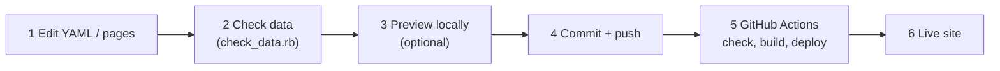

# Editing guide
{: .no_toc }

How to fill in the documentation, check it, and publish it.
{: .fs-6 .fw-300 }

<details open markdown="block">
  <summary>Contents</summary>
  {: .text-delta }
- TOC
{:toc}
</details>

## How this site works

Every hostname, port, database, connection and proxy route is written **once** in a YAML file under
`_data/`. Every table and diagram on the site is generated from those files. So:

- To change a fact (a host, a port, who talks to whom), **edit the YAML**, not the page.
- The Markdown pages under `docs/` only hold page structure and hand-written text (purpose,
  configuration notes).
- When you push to `main`, GitHub checks the data, builds the site and publishes it, usually within
  2–3 minutes.



## 1. Get the repository

You need [Git](https://git-scm.com/) and access to the repository.

```sh
git clone https://github.com/<ORG>/service-docu.git
cd service-docu
```

Already have it? Update it before you start, so you don't edit an old copy:

```sh
git pull
```

## 2. Know which file holds what

| What you want to document | File |
|:--------------------------|:-----|
| Site title, organization name | `_config.yml` (`title`, `org_name`) |
| Organization overview, links on the home page | `index.md` |
| List of services, their purpose, owners, links | `_data/services.yml` |
| A service's components and their ports | `_data/<service>/components.yml` |
| Logical databases and which component owns each | `_data/<service>/databases.yml` |
| Hostnames, database servers and database names per environment | `_data/<service>/environments.yml` |
| Sites (data centres), database-cluster nodes, Kubernetes clusters | `_data/<service>/environments.yml` |
| Who connects to whom (components, databases, external services) | `_data/<service>/connections.yml` |
| External dependencies (APIs, mail relays, ...) | `_data/<service>/external.yml` |
| Reverse proxies and routes per environment | `_data/<service>/proxy.yml` |
| A component's purpose, on-call notes and configuration notes (free text) | `docs/<service>/components/<component>.md` |
| Step-by-step guides (deploy, failover, maintenance) | `docs/<service>/guides/<guide>.md` |

`<service>` is the service's **slug**: a short lowercase name with hyphens, such as `billing-platform`.
The same slug is used for the `_data/` folder and the `docs/` folder.

## 3. Fill in the information

Work through the files **in this order**, because later files refer to ids defined in earlier ones.
Every file starts with a comment that explains its fields.

{: .warning }
Everything in the repository today is **placeholder data** (`<ORG NAME>`, `example-service`,
`component-a`, `*.example.internal`). Replace all of it before you share the site.

### 3.1 Site and home page

In `_config.yml`, set:

```yaml
title: Acme Service Docs
org_name: "Acme Ltd"
```

In `index.md`, replace the paragraph under *Organization overview* and the placeholder links
under *Links*.

### 3.2 Rename the example service to your service

Do this once, for your first service. In the example below the new slug is `billing-platform`
and the title is `Billing Platform`.

1. Rename the folders:
   ```sh
   git mv _data/example-service _data/billing-platform
   git mv docs/example-service docs/billing-platform
   ```
2. In `_data/services.yml`, set `slug: billing-platform` and `title: Billing Platform`.
3. In **every** file under `docs/billing-platform/`, update the front matter (the block between the
   `---` lines at the top):
   - `service: example-service` → `service: billing-platform`
   - `docs/billing-platform/index.md`: `title: Billing Platform`
   - `test.md`, `prod.md`, `components/index.md`, `guides/index.md`: `parent: Billing Platform`
   - every component page and every guide: `grand_parent: Billing Platform`

{: .note }
The sidebar is built from these titles, so `title`, `parent` and `grand_parent` must match
**exactly**. The data check (step 4) reports any mismatch.

### 3.3 Service: `_data/services.yml`

```yaml
- slug: billing-platform
  title: Billing Platform
  summary: Invoicing and payments for all customer channels.
  purpose: |
    Billing Platform creates invoices, charges customers and reconciles payments.
    It is used by the web shop, the mobile app and the finance team.
  owners:
    - { name: Payments Team, role: Service owner, contact: payments@acme.example }
    - { name: Jane Doe, role: Technical lead, contact: jane.doe@acme.example }
  links:
    - { name: Source repository, url: "https://git.acme.example/billing" }
```

`purpose` may use Markdown (lists, **bold**, links).

### 3.4 Components: `components.yml`

One entry per component (application, worker, UI, ...):

```yaml
- id: invoice-api            # lowercase, hyphens; must be unique within the service
  name: Invoice API          # display name; must equal the title of the component page
  description: REST API for creating and querying invoices.
  team: Payments Team
  code_repo: "https://git.acme.org/payments/invoice-api"          # optional
  deploy_repo: "https://git.acme.org/payments/invoice-api-deploy" # optional
  ports:
    - { port: 8080, protocol: http, purpose: REST API }
    - { port: 9090, protocol: http, purpose: Metrics }
```

Then create one page per component (see [Adding and removing things](#adding-and-removing-things)).

### 3.5 Databases: `databases.yml`

One entry per **logical** database. Where it runs is described per environment in step 3.6.

```yaml
- id: invoices-db
  name: Invoices DB         # display name in diagrams and tables
  engine: PostgreSQL 16
  owner: invoice-api         # the component that owns the schema
```

Other components may use the same database. You describe that in `connections.yml`, and it shows
up as dashed "access" lines in the diagrams.

### 3.6 Environments: `environments.yml`

One entry per environment (`test`, `prod`, ...). Every component and every database must appear
in every environment.

```yaml
- id: prod
  name: Prod
  components:
    invoice-api: { hosts: [inv-01.prod.acme.internal, inv-02.prod.acme.internal] }
    payment-worker: { hosts: [pay-01.prod.acme.internal] }
  db_servers:                                  # optional: servers hosting several databases
    pg-main: { host: pg-cluster.prod.acme.internal, port: 5432, notes: Primary + 2 replicas }
  databases:
    invoices-db: { server: pg-main, schema: invoices }      # on a shared server
    payments-db: { server: pg-main, schema: payments }
    queue: { host: redis-01.prod.acme.internal, port: 6379, schema: "db 0" }   # own host
```

A database uses **either** `server` (an id from `db_servers`) **or** its own `host` and `port`,
never both. `schema` is the database or schema name on that server. A database on the same host as
a component (for example a search engine next to the app) is drawn inside a "<component> host" box.

#### Kubernetes

A component deployed to Kubernetes gets a `cluster` and `namespace` instead of `hosts`. Declare the
cluster once per environment under `clusters`:

```yaml
- id: prod
  name: Prod
  clusters:
    k8s-prod: { type: Kubernetes, api: "https://k8s-prod.acme.internal:6443", sites: [dc1, dc2], notes: Stretched cluster }
  components:
    invoice-api: { cluster: k8s-prod, namespace: billing, replicas: 3 }   # on Kubernetes
    payment-worker: { hosts: [pay-01.prod.acme.internal] }                # on a VM
```

`type` can be anything (`OpenShift`, `k3s`, ...) and `replicas` is optional. Diagrams show the
cluster and namespace under the component's name.

#### Database cluster over several sites

List the sites (data centres) once per environment, then list the cluster's `nodes` under its
`db_servers` entry. `host` stays the address the applications connect to (VIP or DNS name):

```yaml
- id: prod
  name: Prod
  sites:
    dc1: { name: DC1 North, notes: Primary site }
    dc2: { name: DC2 South, notes: Disaster-recovery site }
  db_servers:
    pg-main:
      host: pg-cluster.prod.acme.internal
      port: 5432
      notes: Patroni, synchronous replica in DC2
      nodes:
        - { host: pg-01.dc1.acme.internal, site: dc1, role: primary }
        - { host: pg-02.dc1.acme.internal, site: dc1, role: replica }
        - { host: pg-03.dc2.acme.internal, site: dc2, role: replica }
```

The environment page then gets a **Sites and clusters** section: one box per site with the nodes
and clusters there, and replication edges from the `primary` (or `leader`) node to the others.
`sites`, `clusters` and `nodes` are all optional; an environment without them looks as before.

**Active in several sites at once** (Galera, multi-primary, CockroachDB, ...): add a site per
location and give every node `role: primary`. With more than one primary (or none), the diagram
draws one two-way "sync" edge between each pair of nodes instead of one-way replication arrows. A
Kubernetes cluster stretched over the same sites lists them all: `sites: [dc1, dc2, dc3]`.

```yaml
  sites:
    dc1: { name: DC1 North, notes: Active }
    dc2: { name: DC2 South, notes: Active }
    dc3: { name: DC3 Pärnu, notes: Active }
  db_servers:
    galera:
      host: db.prod.acme.internal
      port: 3306
      notes: MariaDB Galera, writes in all sites
      nodes:
        - { host: db-01.dc1.acme.internal, site: dc1, role: primary }
        - { host: db-02.dc2.acme.internal, site: dc2, role: primary }
        - { host: db-03.dc3.acme.internal, site: dc3, role: primary }
```

### 3.7 Connections: `connections.yml`

One line per network connection a component opens. `from` is a component; `to` is a component,
a database or an external dependency.

```yaml
- { from: invoice-api, to: invoices-db, protocol: tcp, port: 5432, description: Invoice data }
- { from: invoice-api, to: payment-worker, protocol: grpc, port: 9000, description: Submits payments }
- { from: payment-worker, to: card-gateway, protocol: https, port: 443, description: Card charges }
```

Every database needs at least one connection from its owner. Traffic from proxies doesn't go here;
it goes in `proxy.yml`.

### 3.8 External dependencies: `external.yml`

Anything outside the service that components connect to: vendor APIs, the company mail relay,
another team's service.

```yaml
- id: card-gateway
  name: Card Gateway
  url: "https://api.cardgateway.example/v3"
  vendor: CardGateway Inc.
  notes: Sandbox URL is used in test.
```

Which components use it is worked out from `connections.yml`, so you don't list them here.

### 3.9 Proxies: `proxy.yml`

Per environment, a list of reverse proxies. Typically one for the internet and one for the intranet.

```yaml
prod:
  - id: internet               # use the same id in every environment
    name: Internet proxy
    clients: Internet          # who connects to it
    type: nginx
    host: proxy.acme.example
    listen: [{ protocol: https, port: 443 }]
    routes:
      - { public_host: billing.acme.example, path: /api/, component: invoice-api, port: 8080, tls: Terminated at proxy, notes: Rate limited }
  - id: intranet
    name: Intranet proxy
    clients: Intranet
    type: HAProxy
    host: proxy.acme.internal
    listen: [{ protocol: https, port: 443 }]
    routes:
      - { public_host: billing.acme.internal, path: /metrics/, component: invoice-api, port: 9090, tls: Terminated at proxy, notes: "" }
```

A route's `port` must be one of the component's `ports` from `components.yml`.

### 3.10 Free text on component pages

Open `docs/<service>/components/<component>.md` and replace the placeholder text in the
**Purpose**, **On-call** and **Configuration notes** sections. Leave the lines with `include` in them as they
are; they generate the tables and diagrams.

**On-call** is what the person on duty reads first when something breaks: how to check the
component is healthy, where its logs are, how to restart it safely, known problems and their fixes,
and who to escalate to. Replace each _not documented yet_ with the real answer.

{: .warning }
Never put passwords, tokens or other secrets in this repository. For secrets, write down only
their **names** and where they are stored.

### YAML tips

- Indent with **spaces**, never tabs. Keep items of a list aligned.
- Put text in quotes when it contains `: `, `#`, or starts with `<`, `{`, `[`, `*`, `&`, `!`, `@`
  or a backtick. For example: `notes: "Note: restricted"`.
- Write ports as plain numbers (`port: 5432`), not in quotes.
- Ids (`id`, `component`, `server`, `from`, `to`) are lowercase with hyphens and must match exactly.
- `<`, `&` and `|` are safe in names and descriptions; they're escaped when the site is built.

## 4. Check your changes

The data check finds broken references before GitHub does. Examples are a typo in an id, a component
missing from an environment, a route to a port the component doesn't listen on, or a page title
that doesn't match.

**With Ruby installed** (3.3 or newer):

```sh
ruby scripts/check_data.rb
```

**With Docker instead:**

```sh
docker run --rm -v "$PWD":/srv -w /srv ruby:3.4 ruby scripts/check_data.rb
```

When everything is fine it prints `Data OK: 1 service(s) checked.`. Otherwise it lists every
problem, for example:

```text
ERROR billing-platform: environment 'prod' is missing component 'payment-worker'
ERROR billing-platform: proxy.yml prod/internet: route billing.acme.example/api/: port 8081 is not a port of 'invoice-api'
```

Fix them and run it again.

{: .important }
You can skip this step, because GitHub runs the same check on every push. Running it locally is
faster than waiting for the build to fail.

## 5. Preview the site (optional)

To see the result before publishing:

```sh
# with Ruby
bundle install            # first time only
bundle exec jekyll serve

# or with Docker
docker run --rm -it -p 4000:4000 -v "$PWD":/srv -w /srv ruby:3.4 \
  sh -c "bundle install && bundle exec jekyll serve --host 0.0.0.0"
```

Open <http://127.0.0.1:4000/service-docu/>. Pages rebuild when you save a file; reload the browser.
Stop the preview with <kbd>Ctrl</kbd>+<kbd>C</kbd>.

## 6. Commit and push

See what you changed:

```sh
git status
git diff
```

Commit and push:

```sh
git add -A
git commit -m "docs: add prod database servers for billing-platform"
git push
```

Write the commit message as `docs: <what changed>`, so the history shows what was updated.

{: .note }
If `git push` is rejected because someone else pushed first, run `git pull --rebase` and then
`git push` again.

### Bigger changes: use a pull request

For larger edits, or when someone should review first, push to a branch and open a pull request.
GitHub checks and builds the pull request but doesn't publish it.

```sh
git switch -c update-billing-prod
git add -A
git commit -m "docs: update billing prod hosts"
git push -u origin update-billing-prod
```

Then open the link that `git push` prints, create the pull request, and merge it when the check is
green. Merging publishes the change.

## 7. Confirm it's published

1. On GitHub, open the repository's **Actions** tab. The run *Build and deploy to GitHub Pages*
   for your commit should finish with a green check in 2–3 minutes.
2. Open the site: `https://<ORG>.github.io/service-docu/`. Reload with
   <kbd>Ctrl</kbd>+<kbd>Shift</kbd>+<kbd>R</kbd> if you still see the old version.

If the run is red, open it and expand the failed step:

| Failed step | What it means | What to do |
|:------------|:--------------|:-----------|
| Validate data files | A reference or required field is wrong | Read the `ERROR` lines, fix the data, push again |
| Build with Jekyll | A YAML syntax error or a broken page | Look for the file name in the error (often a missing quote or bad indentation) |
| Deploy to GitHub Pages | Publishing failed | Usually temporary; use **Re-run jobs** |

## Adding and removing things

Every addition is "add data entries, then copy a page if the thing has its own page". Run the data
check afterwards; it tells you what's still missing.

### Add a component

1. Add it to `components.yml`.
2. Add where it runs (`hosts`, or `cluster` and `namespace`) to every environment in
   `environments.yml`.
3. Add its connections to `connections.yml`, and its routes to `proxy.yml` if it's reachable
   through a proxy.
4. If it owns a database, add the database to `databases.yml` and to every environment.
5. Copy an existing component page:
   ```sh
   cp docs/<service>/components/<existing>.md docs/<service>/components/<new-id>.md
   ```
   In the copy, set `title` (= the component's `name`), `component` (= its `id`) and `nav_order`
   (its position in the sidebar), then rewrite *Purpose*, *On-call* and *Configuration notes*.

### Add a guide

Guides are hand-written how-tos (deploy, failover, maintenance); each one is its own page under
**Guides** in the sidebar, and the Guides page and service page list them automatically.

1. Copy an existing guide:
   ```sh
   cp docs/<service>/guides/<existing>.md docs/<service>/guides/<new-guide>.md
   ```
2. In the copy, set `title`, `nav_order` (position in the sidebar) and `description` (one line,
   shown in the list of guides). Keep `parent: Guides`, `grand_parent: <Service title>` and
   `service`.
3. Write the guide. It can pull current facts from the data, for example
   `` (see the example guides).

If the service has no guides yet, copy `docs/example-service/guides/index.md` first and set its
`parent` and `service`.

### Add a database or database server

Add the database to `databases.yml`, give it a location in every environment, and add the owner's
connection to `connections.yml`. For a new shared server, add it under `db_servers` in that
environment.

### Add a proxy or route

Add the proxy to each environment's list in `proxy.yml`, or add a route to an existing proxy.

### Add an environment

1. Add an entry to `environments.yml` with every component and database.
2. Add the environment's proxies to `proxy.yml` under its id.
3. Copy `docs/<service>/test.md` to `docs/<service>/<env-id>.md` and set `title`, `env` and
   `nav_order`.

### Add a service

1. Add it to `_data/services.yml`.
2. Copy `_data/<existing-service>/` to `_data/<new-slug>/` and replace the data.
3. Copy `docs/<existing-service>/` to `docs/<new-slug>/` and update the front matter as in
   [step 3.2](#32-rename-the-example-service-to-your-service). Give the service page a
   `nav_order` between 2 and 98, so it appears above this guide.

### Remove something

Delete its data entries **and** every reference to it: connections, proxy routes, environment
entries, and its page if it has one. The data check lists any references you missed.
